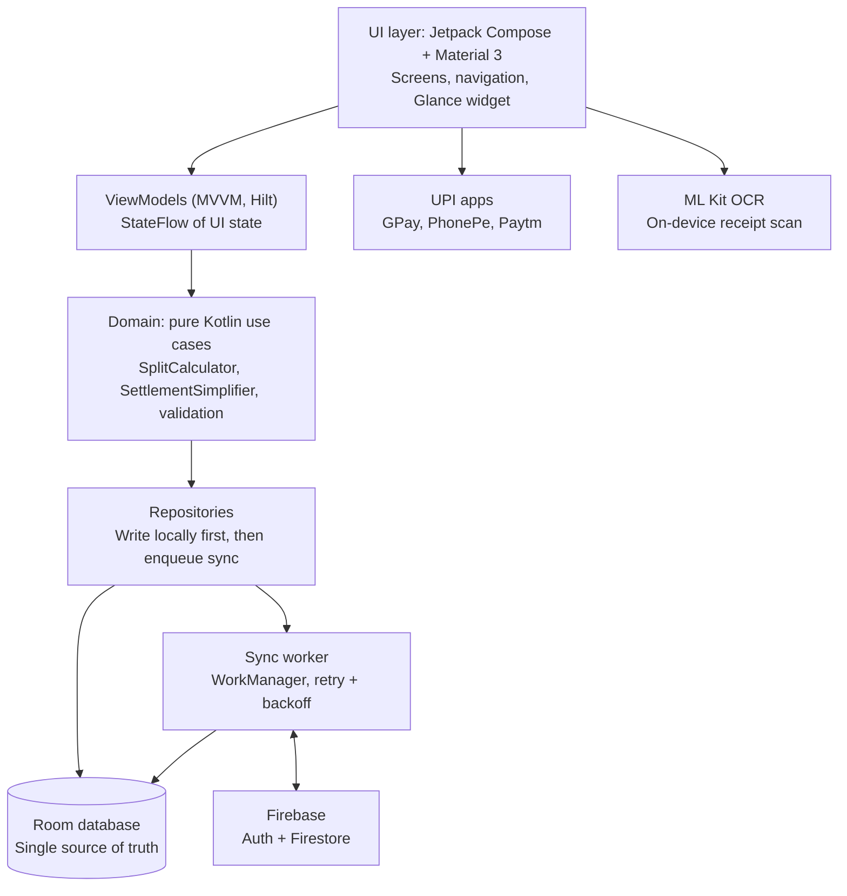

# SplitEasy — Product Requirements Document

Oct 17, 2026 · Lokesh Reddy · Updated after review: detailed product decisions are recorded in `docs/OPEN_QUESTIONS.md`

## Overview

SplitEasy is an offline-first Android app for splitting shared expenses within a group and settling up in one tap through UPI. It is built as a portfolio project to show modern Android engineering: Jetpack Compose, local-first data, background sync and well-tested business logic.

**Problem.** Friends, flatmates and travel groups track shared spending in chat threads or spreadsheets. Totals get lost, nobody knows who owes whom, and settling up means manually typing amounts into a UPI app. Existing apps often need a network connection to add an expense and rarely connect directly to UPI.

**Solution.** Add expenses anywhere, even with no signal, and see a simplified "who owes whom" summary. Settle each debt with a prefilled UPI payment, and let changes sync to the group automatically when the phone is back online.

## Goals and non-goals

The primary goal is a polished, demoable app with clean architecture that stands up in a technical interview.

**Goals**

- Let a group record shared expenses with equal, exact or percentage splits
- Show each member a simplified list of who owes whom, with the fewest possible payments
- Settle a debt through a prefilled UPI payment in one tap
- Work fully offline and sync reliably when back online
- Demonstrate a modern, tested Android codebase with CI

**Non-goals (for v1)**

- Processing or verifying payments inside the app (UPI apps handle the payment)
- Multiple currencies or currency conversion
- iOS or web clients
- Monetization, ads or subscriptions

**Success metrics**

| Metric | Target |
| --- | --- |
| Cold start time on a mid-range device | Under 1.5 s |
| Add an expense, from tap to saved | Under 15 s for a new user |
| Unit test coverage of split and settlement logic | 90% or higher |
| Crash-free sessions in testing | 99% or higher |
| Sync after reconnect | All pending changes uploaded within 1 minute |
| Portfolio proof | Public repo, README with demo GIF, signed APK release |

## Target users

The core user is a young adult in India who shares recurring or one-off costs with a small group and already pays through UPI.

| Persona | Situation | Main need |
| --- | --- | --- |
| Flatmate | Shares rent, groceries, electricity and Wi-Fi with 2-4 people | Recurring expenses and a clear monthly settle-up |
| Trip organiser | Plans a weekend trip with 5-8 friends, often in low-network areas | Add expenses offline, settle everything after the trip |
| Office group | Splits lunches, cab rides and gifts with colleagues | Quick equal splits and minimal follow-up |
| Couple | Shares household and travel costs | A running balance without awkward reminders |

**Key use cases**

1. Create a group and invite members
2. Add an expense and choose how to split it
3. Check balances and see who owes whom
4. Settle a balance through UPI and mark it paid
5. Review group history and spending by category

## User stories

Each story maps to a requirement in the next section.

| ID | As a... | I want to... | So that... |
| --- | --- | --- | --- |
| US-1 | New user | Sign in with Google | My groups are backed up and synced across devices |
| US-2 | User | Create a group and add members by name or invite link | Everyone sharing costs is in one place |
| US-3 | Member | Add an expense with amount, payer, category and note | The group has a record of what was spent |
| US-4 | Member | Split an expense equally, by exact amounts or by percentage | Uneven costs are shared fairly |
| US-5 | Member | Add expenses with no internet | I can track spending on trips or in poor network areas |
| US-6 | Member | See who owes whom with the fewest payments | Settling up takes as few transactions as possible |
| US-7 | Member who owes money | Tap Pay to open my UPI app with the amount prefilled | I can settle in seconds |
| US-8 | Member who was paid | Mark a debt as settled | Balances stay accurate |
| US-9 | Member | Edit or delete an expense I added | Mistakes can be fixed |
| US-10 | Member | Scan a receipt to prefill the amount | I type less |
| US-11 | Member | See my net balance on a home-screen widget | I know where I stand without opening the app |
| US-12 | Member | See spending by category and month | I understand where group money goes |
| US-13 | Member | Export a group summary as PDF or CSV | I can share it outside the app |

## Functional requirements

P0 items make up the MVP; P1 items make the app stand out; P2 items are nice to have if time allows. **v1.0 scope = all P0 + P1. P2 is out of scope.**

| ID | Requirement | Priority | Stories |
| --- | --- | --- | --- |
| FR-1 | Google sign-in with Firebase Auth; app stays usable offline after first sign-in | P0 | US-1 |
| FR-2 | Create, rename and archive groups; add or remove members, including guest members tracked by name | P0 | US-2 |
| FR-3 | Add, edit and delete expenses with amount, payer, date, category and note | P0 | US-3, US-9 |
| FR-4 | Split types: equal, exact amounts, percentage; validate that splits add up to the total | P0 | US-4 |
| FR-5 | Store amounts in paise as Long, never Float or Double; handle rounding remainders deterministically | P0 | US-4 |
| FR-6 | All writes go to the local database first and appear instantly | P0 | US-5 |
| FR-7 | Balances screen showing each member's net position and a simplified list of payments | P0 | US-6 |
| FR-8 | Pay button that launches a UPI intent with payee VPA, name, amount and note prefilled | P0 | US-7 |
| FR-9 | Record a settlement as a special transaction that updates balances; a UPI SUCCESS result creates it as pending with its txnId, and the payee confirms or rejects it. A manual record is pending when the payer records it, and confirmed when the payee records it or either side is a guest. Only confirmed settlements change balances | P0 | US-8 |
| FR-10 | Background sync of pending changes when online, with retry and backoff | P0 | US-5 |
| FR-11 | Invite members through a shareable link: a Firebase Hosting web link that opens the app through Android App Links, with a 6-character code as a fallback. Links expire after 7 days and can be revoked | P1 | US-2 |
| FR-12 | Receipt scan with ML Kit text recognition to prefill amount and merchant | P1 | US-10 |
| FR-13 | Home-screen widget showing net balance across groups (Jetpack Glance) | P1 | US-11 |
| FR-14 | Category and monthly spending charts | P1 | US-12 |
| FR-15 | Export a group summary to PDF or CSV and share it | P2 | US-13 |
| FR-16 | Settle-up reminders through local notifications | P2 | US-7 |
| FR-17 | Recurring expenses such as monthly rent | P2 | US-3 |

## Non-functional requirements

The app must feel instant, never lose data, and keep money math exact.

| Area | Requirement |
| --- | --- |
| Offline | Every core action (add, edit, view balances) works with no network; Room is the single source of truth |
| Data integrity | No expense is lost or duplicated during sync; each record has a client-generated UUID and an updatedAt timestamp |
| Correctness | Money stored as integer paise; split and settlement logic covered by unit tests, including rounding edge cases |
| Performance | Cold start under 1.5 s; lists of 1,000 expenses scroll at 60 fps |
| Security | No secrets in the APK; Firestore security rules allow access only to group members and enforce role and ownership checks (group creator, expense creator, payee, guest status, UPI ID owner); UPI IDs are editable only by their owner and readable only by members of groups they share. A guest's UPI ID can be set by any member until the guest links an account, and every change is recorded in the group feed |
| Accessibility | Content descriptions on icons, touch targets of 48 dp or more, support for system font scaling and TalkBack |
| Compatibility | minSdk 26 (Android 8.0), targetSdk latest stable; portrait and landscape; light and dark themes |
| Quality | Lint, ktlint and unit tests run on every push through GitHub Actions |

## Technical architecture

SplitEasy uses a layered MVVM architecture where every read and write goes through Room, and a WorkManager job syncs with Firebase in the background.



The UI never waits on the network: repositories save to Room, the UI updates from Room's Flow, and the sync worker pushes and pulls changes when the device is online.

### Tech stack

| Concern | Choice |
| --- | --- |
| Language | Kotlin |
| UI | Jetpack Compose, Material 3, Navigation Compose |
| Architecture | MVVM with a domain layer of use cases |
| Dependency injection | Hilt |
| Async | Coroutines and Flow |
| Local storage | Room |
| Background work | WorkManager |
| Backend | Firebase Auth and Cloud Firestore |
| OCR | ML Kit Text Recognition (on-device) |
| Widget | Jetpack Glance |
| Testing | JUnit, MockK, Turbine, Compose UI tests |
| CI | GitHub Actions |

### Data model

| Entity | Key fields |
| --- | --- |
| GroupEntity | id (UUID), name, createdBy, updatedAt, isArchived, syncState, isDeleted |
| MemberEntity | id, groupId, displayName, userId (optional), upiId (optional), updatedAt, syncState, isDeleted |
| ExpenseEntity | id, groupId, paidBy, amountPaise (Long), description, category, date, splitType, createdBy, updatedAt, syncState, isDeleted |
| ExpenseShareEntity | expenseId, memberId, sharePaise (Long); synced inside its expense's Firestore document |
| SettlementEntity | id, groupId, fromMemberId, toMemberId, amountPaise, date, upiTxnId (optional), status (PENDING, CONFIRMED, REJECTED), updatedAt, syncState |
| GroupEventEntity | id, groupId, actorMemberId, targetMemberId, type (GUEST_UPI_CHANGED), oldValue (optional), newValue, createdAt, syncState; append-only, never edited or deleted |

### Settlement algorithm

Each member's net balance is what they paid minus what they owe, adjusted for settlements:

```
net(i) = sum(paid by i) - sum(shares of i) + sum(settlements sent by i) - sum(settlements received by i)
```

Members with a positive net are creditors and those with a negative net are debtors. A greedy pass repeatedly matches the largest debtor with the largest creditor, records a payment of the smaller amount, and repeats until all balances are zero. This produces at most n - 1 payments for n members and runs in O(n log n) with two priority queues.

### Sync strategy

- Every record has a client-generated UUID, an updatedAt timestamp and a syncState of PENDING or SYNCED
- Local writes set syncState to PENDING and enqueue a unique WorkManager job with a network constraint and exponential backoff
- The worker uploads pending records in Firestore batches, then marks them SYNCED
- A Firestore snapshot listener on active groups writes remote changes into Room
- Conflicts resolve by last write wins on updatedAt; deletes are soft deletes so they sync like any other change
- Expense shares are stored inside their expense's Firestore document; group events are their own append-only collection under the group
- A change to a guest's UPI ID and its group event are written in the same Firestore batch, and the security rules use `getAfter()` to require a matching event
- Firestore rules can't add up balances, so the "balance must be zero" checks (archive a group, remove a member, leave) run in the app and are covered by unit tests; this is listed in the README as a known limitation

## Key screens and flows

See `docs/designs/` for the visual designs of every screen.

| Screen | What it shows | Main actions |
| --- | --- | --- |
| Sign in | App intro and Google sign-in | Sign in |
| Groups home | List of groups with your net balance in each, total balance on top | Create group, open group |
| Group detail | Expense feed, newest first, with a balance summary card | Add expense, view balances, settings |
| Add or edit expense | Amount, description, payer, category, date, split type and per-member shares | Save, scan receipt |
| Balances | Payments that need your confirmation, payments waiting for confirmation, the simplified who-owes-whom list, and each member's net position | Pay via UPI, record a payment, confirm or reject, cancel your pending payment |
| Insights | Spending by category, by month (last 6 months) and who paid; across all groups it shows your share and hides who paid | Change group (including All groups) and period (a month or All time) |
| Profile and settings | Name, UPI ID, theme, sync status | Edit UPI ID, sign out |

**Add expense flow**

1. From Group detail, tap the add button
2. Enter the amount (or scan a receipt to prefill it) and a description
3. Choose who paid and the split type; adjust shares if needed
4. Save: the expense appears instantly and is marked as pending sync
5. WorkManager uploads it when the device is online

**Settle-up flow**

1. Open Balances and find a payment you owe
2. Tap Pay: the app builds a UPI link with the payee's UPI ID, name, amount and a note
3. Android shows the UPI app chooser; you complete payment in GPay, PhonePe or Paytm
4. Return to SplitEasy; if the UPI app reports SUCCESS, a pending settlement is saved with its transaction ID. On FAILURE or no response, the app offers "Payment didn't go through? Record payment"
5. The payee confirms the settlement, balances update, and it syncs to the group

## Milestones and timeline

The build takes six weeks: all P0 requirements are done by the end of week 4, leaving two weeks for standout features and release polish.

| Phase | Weeks | Deliverables |
| --- | --- | --- |
| Foundations | 1-2 | Project setup, Room schema, split logic + tests |
| Core UI and settle-up | 2-3 | Compose screens, balances, UPI |
| Auth and sync | 4 | Firebase Auth, WorkManager sync — **MVP (P0) complete** |
| Standout features | 5 | Invite links, receipt OCR, widget, charts |
| Polish and release | 6 | README, demo GIF, signed APK — **v1.0 release** |

If a phase runs late, cut P1 items from week 5 rather than moving the release.

**Exit criteria for v1.0**

- [ ] All P0 requirements work offline and sync correctly between two devices
- [ ] Split and settlement logic at 90% or higher unit test coverage, green in CI
- [ ] README with feature list, architecture diagram, screenshots and demo GIF
- [ ] Signed APK published as a GitHub release, tagged v1.0

## Risks, open questions and future scope

The biggest risk is scope creep; P1 and P2 items are cut before the MVP slips.

| Risk | Impact | Mitigation |
| --- | --- | --- |
| Sync conflicts when two members edit the same expense offline | Wrong balances | Last-write-wins on updatedAt per expense; deletes are soft deletes so they sync too |
| UPI apps cannot report whether payment succeeded reliably | False "settled" records | Read the UPI intent result; on SUCCESS create a pending settlement with the txnId, which only becomes final when the payee confirms; settlement can be undone |
| Some UPI apps block payment requests from third-party apps to personal UPI IDs | Payment fails even though the app is correct | Offer "Record payment" on failure or no response; document the limitation in the README |
| Rounding errors in percentage splits | Totals off by a paisa | Integer paise; assign remainder to the payer; covered by unit tests |
| Firebase free-tier limits | Sync stops for heavy use | Batch writes, listen only to active groups; fine at portfolio scale |
| Scope creep | Project never ships | Ship P0 first, tag v1.0 release, then add P1 features one by one |

**Decisions**

- [x] Members without the app are supported as "guest" members tracked only by name, who can link a real account when they sign up
- [x] Sync backend: Firebase (Auth and Cloud Firestore)
- [x] Release signed APKs on GitHub only for now; the Play Store is out of scope for v1
- [x] Stay on the free Firebase plan: no Cloud Functions and no push notifications in v1. Payees see payments waiting for their confirmation in the app, with a count badge on the group row
- [x] Detailed product decisions (permissions, settlement rules, rounding, categories, invites and more) are in `docs/OPEN_QUESTIONS.md`

**Future scope**

In-app account deletion (required before any Play Store release), server-side balance checks with Cloud Functions, multi-currency trips, recurring expenses, shared group chat on each expense, a Wear OS tile, and an AI assistant that turns "I paid 1,200 for dinner, split with Ravi and Priya" into an expense.
